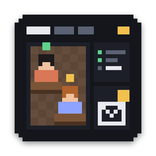
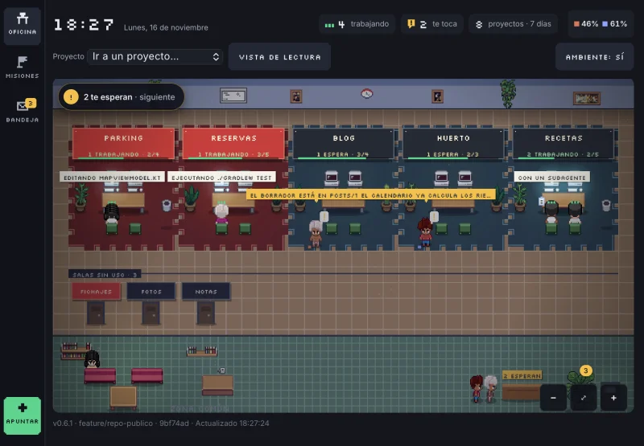
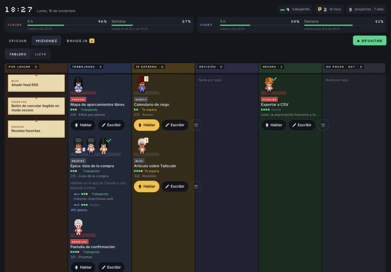
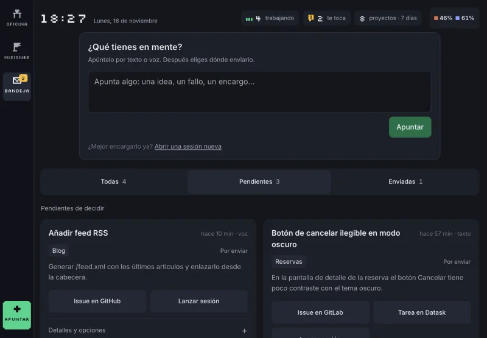
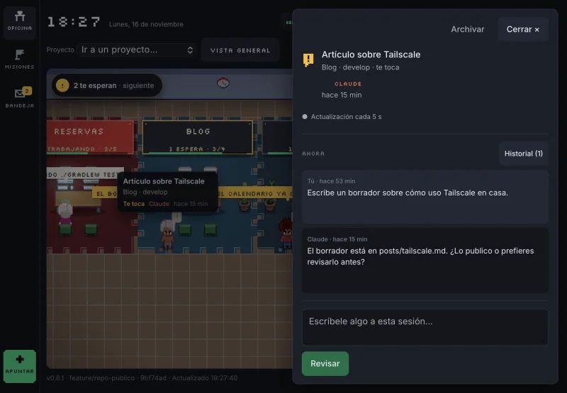
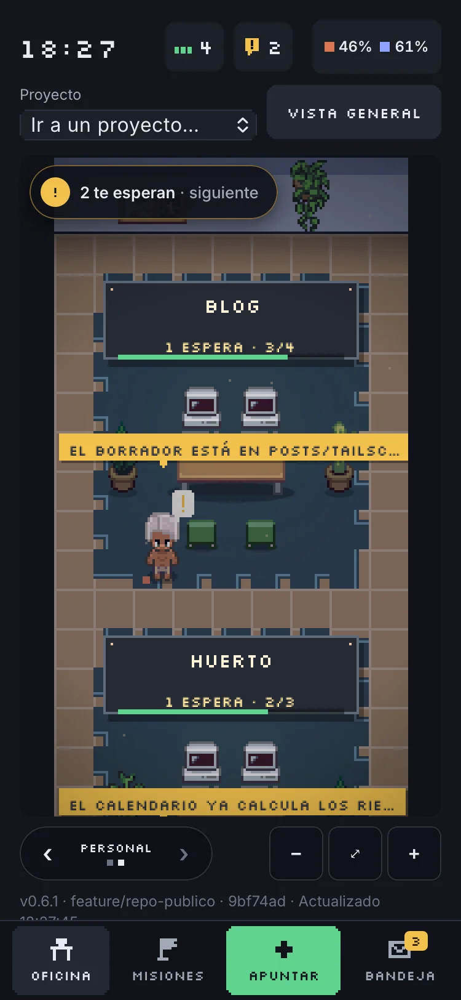
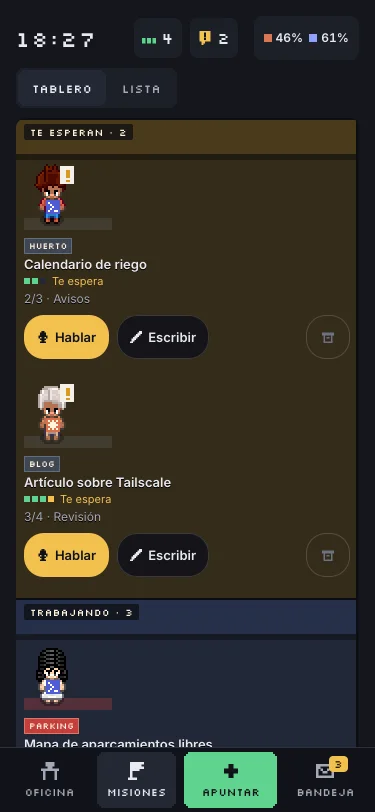

<p align="center"></p>

<h1 align="center">Dashboard</h1>

<p align="center">Todas tus sesiones de Claude Code y Codex, de un vistazo.<br>Una oficina en pixel art donde cada sesión de tu Mac es un personaje: quién trabaja, quién te espera y quién ha terminado.</p>

<p align="center"><b>Node 24, sin dependencias</b> · <b>solo en tu Mac y tu tailnet</b> · <b>app de barra de menú incluida</b></p>



<sub>Todas las capturas son de una instancia de demostración con proyectos y sesiones inventados.</sub>

> **In English.** Dashboard is a local, dependency-free Node 24 web panel that turns the Codex and Claude Code sessions on your Mac into a pixel-art office. Each project is a desk and each session a character: you see at a glance who is working, who is waiting for you and who is done, on the Mac or on a tablet or phone over your Tailscale tailnet. It is an overview to keep track of your agents when you are away from the computer, not a replacement for Codex in the ChatGPT app or Claude Remote Control: you keep working in those apps, each session links to its own app, and replies, approvals or stops can also be sent from the panel when it is handy. It reads the apps' own logs read-only, listens on `127.0.0.1` only, and every command is reviewed before it is sent. It also has a mission board for coordinator and delegate sessions, an inbox that turns dictated notes into issues or new sessions, and a Swift menu-bar app. The interface is in Spanish.

## Qué es

Con varias sesiones abiertas entre Codex, Claude Code y sus subagentes es fácil perder la que lleva media hora esperando una respuesta. El panel lee los registros que esas apps ya guardan en el Mac y los convierte en estados que se entienden de lejos, en una pantalla aparte o en la tablet:

| Estado | Cuándo | En la oficina |
| --- | --- | --- |
| **Trabajando** | Turno abierto con actividad en los últimos 15 min | Se sienta a teclear y su pantalla se enciende |
| **Te espera** | Te ha preguntado algo o pide una aprobación (hasta 4 h) | De pie con «!» y en la cola de la recepción |
| **Terminada** | Cerró el turno sin pedirte nada | Suelta unas chispas y se va a la zona común |
| **¿Atascada?** | 10 minutos trabajando sin escribir nada | Un «?» rojo parpadea sobre su cabeza |

Al tocar un personaje se abre su ficha: el último encargo, la respuesta en curso en vivo y el historial.

Con las sesiones se trabaja en Codex y en Claude, como siempre. Dashboard no pretende sustituir a Codex en la app de ChatGPT ni a Remote Control de Claude: es una ayuda para tener la visión global sin estar delante del ordenador. Cuando una sesión te necesita, la ficha la abre en su app (Remote Control para las de la app de Claude; la app de Codex en el Mac o ChatGPT en el móvil). Si te viene mejor, también puedes contestar, aprobar o parar desde el propio panel, escribiendo o dictando. El Mac continúa la sesión en segundo plano con el CLI oficial de su agente.

## Tres vistas

Arriba quedan siempre la hora, los contadores y el uso de las ventanas de 5 horas y semanal de cada agente. El botón **Apuntar** está a mano en todas las vistas.

**Oficina.** Cada proyecto activo de la semana es un puesto con mesa y letrero, que enseña los pasos del plan («3/5» y una barra) y un bocadillo con lo que hace la sesión que más urge. Las coordinadoras llevan un anillo azul, las delegadas de un issue su número y los subagentes entran a ayudar. Se puede pellizcar y hacer zoom; en el móvil las zonas son plantas que se cambian deslizando, y tras un minuto sin tocar nada la cámara pasea entre los puestos.

**Misiones.** Cada coordinadora con sus delegadas forma un equipo, que camina a la sala de su miembro más urgente: Por lanzar, Trabajando, Te esperan, Revisión, Hechas y En pausa. Puedes **Hablar** o **Escribir** a la coordinadora sin abrir su ficha.

**Bandeja.** Dictas o escribes una idea y, en segundos, Haiku propone proyecto, título y descripción eligiendo solo entre tus proyectos. Desde ahí creas un issue en GitHub o GitLab, una tarea en Datask o lanzas una sesión con el encargo. Cada 15 minutos mira si lo creado se ha cerrado y, entonces, archiva la nota.

<table>
  <tr>
    <td width="50%"></td>
    <td width="50%"></td>
  </tr>
  <tr>
    <td>Misiones: los equipos, en la sala de quien más urge.</td>
    <td>Bandeja: cada nota llega con su plan y sus destinos.</td>
  </tr>
  <tr>
    <td width="50%"></td>
    <td width="50%" align="center"> </td>
  </tr>
  <tr>
    <td>Ficha de sesión: se contesta escribiendo o dictando, y se revisa antes de enviar.</td>
    <td>Pensado para el iPhone y el iPad: barra al alcance del pulgar y controles de 44 px.</td>
  </tr>
</table>

El detalle de cada vista, las órdenes, el dictado y las variables está en la [guía de uso](docs/guia.md).

## App de barra de menú

`macos/install.sh` deja el panel como servicio del Mac y compila `Dashboard.app`, una app pequeña en Swift que vive en la barra superior:

- Junto al icono enseña cuántas sesiones trabajan y cuántas te esperan («4·2»), y se apaga si el panel está parado.
- Arranca, para y reinicia el servicio sin abrir la terminal, y abre el registro (`~/Library/Logs/Dashboard.log`).
- Copia la dirección de Tailscale para abrir el panel en la tablet.
- No tiene icono en el Dock y cerrarla no para el panel. `macos/uninstall.sh` lo quita todo.

## Requisitos

Solo son imprescindibles macOS y Node. Cada pieza más enciende una parte del panel; sin ella, esa parte no aparece y el resto sigue funcionando.

| Pieza | Para qué | Cómo tenerla |
| --- | --- | --- |
| **macOS** | El panel lee las apps de Claude y Codex de este Mac. El dictado necesita Apple Silicon | — |
| **Node.js 24** o superior | El servidor. No hay dependencias de npm | `brew install node` |
| **Claude Code** de terminal, con sesión iniciada | Contestar y abrir sesiones de Claude, los planes de la Bandeja y el uso de Claude | `claude` y dentro `/login` |
| **App de Codex** | Trae el CLI que usa el panel para contestar y abrir sesiones de Codex | Instalar la app y entrar con tu cuenta |
| **mlx-whisper** y **ffmpeg** (opcional) | Dictado en el propio Mac. La primera transcripción descarga el modelo `whisper-large-v3-turbo`, de unos 1,6 GB | `brew install pipx ffmpeg` y `pipx install mlx-whisper` |
| **Tailscale** (opcional) | Abrir el panel en la tablet o el móvil por HTTPS; el micrófono solo funciona en `localhost` o por HTTPS | App de Tailscale y `tailscale serve --bg 4317` |
| **gh** o **glab** (opcional) | Crear issues desde la Bandeja y seguir si se cierran | `brew install gh glab` y `gh auth login` / `glab auth login` |
| **CLI de Datask** (opcional) | Crear tareas en Datask, un gestor de tareas por CLI | Solo si ya la usas |
| **Command Line Tools de Xcode** (opcional) | Compilar con `swiftc` la app de barra de menú | `xcode-select --install` |

## Instalación

```bash
git clone https://github.com/jfmargar/dashboard.git
cd dashboard
npm start
```

Abre `http://localhost:4317`. Con `npm run dev` se reinicia al cambiar el código.

Para que arranque solo al iniciar sesión, se levante si se cae y tenga icono en la barra de menú:

```bash
macos/install.sh
```

Con el servicio en marcha, el puerto 4317 está ocupado: para desarrollar usa otro (`PORT=4319 npm run dev`).

Para verlo en la tablet, con Tailscale en el Mac y en la tablet:

```bash
tailscale serve --bg 4317
```

y abre `https://<nombre-del-mac>.<tu-tailnet>.ts.net`.


## Configuración

Lo propio de cada Mac va en `data/config.json`, que git no guarda. Es opcional: sin él, la oficina tiene las zonas Trabajo (`~/Workspace/Trabajo`, destacada en rojo) y Personal (`~/Workspace/Personal`), y todo lo demás va a Otros. Se vuelve a leer al guardarlo, sin reiniciar.

```json
{
  "zones": [
    { "id": "cliente", "title": "Cliente", "path": "~/Code/Cliente", "accent": true },
    { "id": "personal", "title": "Personal", "path": "~/Code/Personal", "datask": false }
  ],
  "logo": "data/logo.svg",
  "projectCodePattern": "\\b(PRJ\\d{3})\\b",
  "datask": { "ignoredWords": ["mantenimiento"] }
}
```

- `zones`: plantas de la oficina, en orden. Cada proyecto cae en la primera cuya `path` contiene su carpeta. `accent` pinta sus puestos en rojo y pone el logotipo en su pared; `"datask": false` no ofrece Datask en sus notas.
- `logo`: imagen para esa pared (ruta con `~/` o relativa al repositorio).
- `projectCodePattern`: expresión regular para reconocer el código de un proyecto en el nombre de su carpeta o de su remoto; la Bandeja lo usa para encontrarlo.
- `datask.ignoredWords`: palabras que se repiten en muchos proyectos de Datask y no sirven para distinguirlos.

## Seguridad

El panel enseña títulos y mensajes de tus sesiones y puede mandarles órdenes, así que está pensado para no salir de tus equipos:

- **Nunca en internet.** El servidor escucha solo en `127.0.0.1`. Fuera del Mac se llega únicamente por tu tailnet con `tailscale serve`, y desde ahí solo se aceptan órdenes de tu propia cuenta de Tailscale. Si alguien lo expone con `tailscale funnel`, otro proxy o `HOST=0.0.0.0`, el panel lo detecta y no enseña nada; tampoco atiende a webs que se hagan pasar por `localhost` (DNS rebinding).
- **Solo lectura de las apps.** No escribe a mano en `~/.codex` ni en `~/.claude`; solo los propios CLI los modifican al ejecutar una orden.
- **Todo pasa por ti.** Cada orden, issue, tarea o sesión nueva se enseña completa y se confirma antes de enviarla; aprobar y parar piden un segundo toque. La interfaz siempre muestra el nivel de permisos con el que trabajará el agente, y Claude nunca se lanza con `bypassPermissions` ni `--dangerously-*`.
- **Tu voz se queda en casa.** El dictado se transcribe en el Mac y el audio no sale de él.

Si encuentras un problema de seguridad, abre un issue sin detalles sensibles y te contacto.

## Desarrollo

```bash
npm test
```

Para enseñar el panel o sacar capturas sin datos reales, `tests/fixtures/demo-world.js` genera un Mac de mentira con proyectos y sesiones inventados. La configuración `dashboard-demo` de `.claude/launch.json` lo genera en `~/Library/Caches/dashboard-demo` y arranca el panel en `http://localhost:4320`. Las capturas de `docs/images/` salen de ahí con `docs/capturas.sh`.

La arquitectura y las reglas del proyecto están en [AGENTS.md](AGENTS.md) y los cambios de cada versión en el [CHANGELOG](CHANGELOG.md).

## Licencia

Código bajo licencia [MIT](LICENSE). Los gráficos son de [pixel-agents](https://github.com/pablodelucca/pixel-agents) (MIT) y del pack [MetroCity de JIK-A-4](https://jik-a-4.itch.io/metrocity-free-topdown-character-pack) (CC0); detalles en [assets/CREDITS.md](assets/CREDITS.md).
